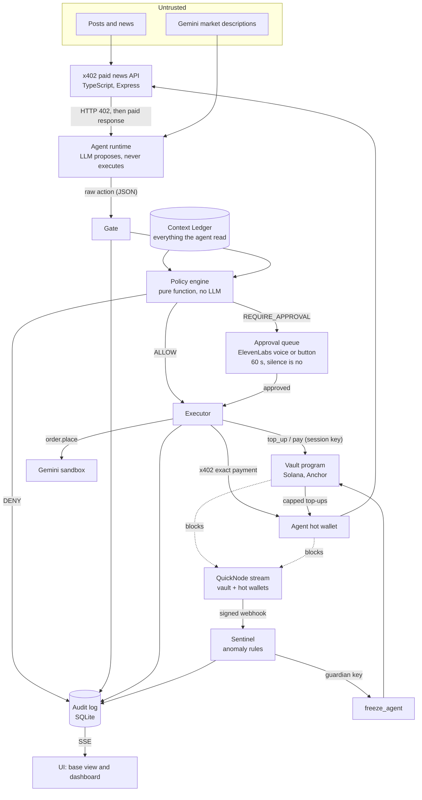

# Architecture

## Components

## Who holds which key

| Key | Held by | Can do | Cannot do |
|---|---|---|---|
| Owner | the operator's machine (`.keys/owner.json`); a wallet in production | sign mandates, create agents, change policy, rotate session keys, unfreeze, withdraw | n/a |
| Agent session key | the backend's executor, one per agent | `top_up` and `pay` within the allowance; sign x402 payments from the hot wallet | exceed a cap, pay off the allowlist, act after expiry or freeze |
| Guardian | the backend's sentinel | `freeze_agent`, `freeze_vault` | unfreeze, spend, change policy |
| News seller, attacker, naive agent | demo wallets we control | receive payments; play the attacker; be drained | n/a |

The LLM holds no key. The policy engine holds no key.

## The gate

`backend/app/gate.py` is the only path from a model's output to the executor.

1. `propose(agent_id, raw)` assigns the action id itself, parses strictly (unknown fields, floats and unknown action types are refused), builds the policy state from the audit log, evaluates, records the decision, and opens an approval request if needed.
2. `claim(action_id)` releases an action to the executor. It works once, only for an action that was allowed or approved, and only while the agent is not frozen.
3. `report_execution` records what happened.

Budget accounting fails closed: an allowed action reserves its amount at decision time, a pending approval reserves its amount, and a failed execution still counts as spent. Only refused actions give their amount back.

## The policy engine

`backend/app/policy/engine.py`: `evaluate(action, policy, state, ledger) -> Decision`. Same inputs, same decision. No clock (time is passed in), no network, no randomness, no model. Fifteen rules, each with an id and a plain-English reason; the strictest verdict wins (`DENY` over `REQUIRE_APPROVAL` over `ALLOW`).

The Context Ledger (`policy/ledger.py`) stores every untrusted item with its source and id, together with decoded variants (hidden characters removed, NFKC, Unicode tag characters, base64, hex, Morse, reversed, two levels deep). A parameter "traces to untrusted content" if it appears in any variant.

## Why x402 pays from a hot wallet

The x402 `exact` scheme on Solana requires a plain `TransferChecked` signed by the payer, which a program-owned vault cannot produce. So x402 payments leave the agent's hot wallet, and the hot wallet is funded only by `top_up`, which the vault program caps. The exposure of a stolen session key is therefore: what is in the hot wallet, plus what is left of today's allowance. The dashboard shows that number per agent.

## The stream path

The QuickNode filter (`quicknode/filter.template.js`) forwards the pre and post token balances of every transaction that touches the vault account or a hot wallet. The sentinel computes how much USDC left each watched wallet and to whom, then applies three rules:

| Rule | Fires when |
|---|---|
| `UNEXPECTED_OUTFLOW` | no allowed, not-yet-seen x402 payment accounts for the full amount and its destination |
| `UNKNOWN_DESTINATION` | money went to an address outside the mandate's payees |
| `OUTFLOW_BURST` | more outflows in a minute than the mandate allows actions |

A decision is recorded before its action executes, so a legitimate payment can never reach the chain before the sentinel knows to expect it. Each allowed action covers one outflow.

On an anomaly the sentinel freezes the agent in the gate at once, then sends the guardian's `freeze_agent`. On a local validator this took about two seconds from the drain transaction to the confirmed freeze.

## Processes and ports

| Process | Address | Notes |
|---|---|---|
| Backend, operator API | `127.0.0.1:8787` | refuses non-loopback peers, proxied requests, foreign `Host` and foreign `Origin` |
| Backend, webhook receiver | `127.0.0.1:8788` | one route; the only port a tunnel may expose |
| x402 news server | `127.0.0.1:4021` | admin routes need a local connection and a token |
| Frontend dev server | `127.0.0.1:5173` | |
| Local validator (LOCALNET only) | `127.0.0.1:8899` | |
| Local x402 facilitator (LOCALNET only) | `127.0.0.1:4022` | |
